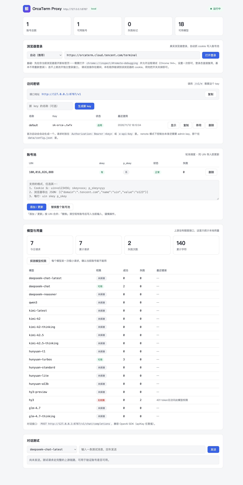

<div align="center">

# OrcaTerm Gateway

**一个本地 OpenAI 兼容入口，轮询多个 OrcaTerm 账号**

[](LICENSE)
[](package.json)

[English](README.en.md) · 中文



</div>

把腾讯云 OrcaTerm 内置的 LightAI 助手接到任何支持 OpenAI Chat Completions API 的客户端。一个本地地址可以轮流使用多个你自己控制的账号。

```text
OpenAI 客户端  ->  localhost:8787  ->  账号池  ->  LightAI
```

> 只能使用你自己控制的账号。代理不会注册账号、恢复凭证，也不会绕过腾讯云登录校验。

## 功能

- 兼容 OpenAI 的 `POST /v1/chat/completions`，支持 JSON 和 SSE 流式响应。
- 一键浏览器登录，自动抓取 Cookie，不用手工复制。
- 本地多账号池，按 UIN 覆盖，按顺序轮询。
- 支持 Cookie 字符串、浏览器 Cookie JSON、Netscape `cookies.txt` 和一行一个账号。
- `system` 与 `developer` 指令按高优先级转发，也可用 `INJECT_SYSTEM` 追加全局指令。
- 上游任务 JSON 收成可见回答；上游文本错误原样透出。
- 本地用量统计与模型权限探测。
- 双密钥访问控制：admin key 管管理面，API key 管 `/v1/*`。
- 空响应和网关错误最多重试三次；确定性失败不重试。

### 浏览器登录

点一下按钮，驱动真实浏览器完成登录，代理自己把会话抓下来。

| 文件 | 作用 |
| --- | --- |
| `src/browser.js` | 跨平台查找 Chrome / Edge / Chromium / Brave（可用 `CHROME_PATH` 覆盖）。用 Node 原生 WebSocket 连 CDP，每条指令都带超时。读 Cookie 有四级降级，成功一次就缓存该通道：页面级 `Network.getCookies` → 浏览器级 `Storage.getCookies` → 页面级 `Storage.getCookies` → 浏览器级 `Network.getAllCookies`。 |
| `src/login.js` | `LoginManager`：三种模式、每次登录用独立临时 profile、任务状态轮询、容错重试，以及全流程日志（stdout 打 `[login:xxxxxxxx] …`）。同名 Cookie 按域精确度去重，`.cloud.tencent.com` 会盖掉过期的 `.tencent.com`。 |
| `src/open-login.js` | `npm run login` 重写。旧版本硬编码 `D:\workplace\…\chrome.exe`，而且根本没有读取 Cookie 的逻辑。 |

三种模式，控制台可选，命令行用 `--attach` / `--launch`：

| 模式 | 行为 |
| --- | --- |
| `auto`（默认） | 先试当前浏览器的新标签页，失败回退独立窗口 |
| `attach` | 只用当前浏览器，连不上直接报错并给出开法 |
| `launch` | 永远用临时 profile 启动独立实例 |

`attach` 走两条路：经典的 `--remote-debugging-port`，或者——因为 **Chrome 136+ 已静默忽略默认 profile 的该参数**——浏览器自带的 `chrome://inspect/#remote-debugging` 开关。后者的端口是随机的，代理从浏览器 User Data 目录下的 `DevToolsActivePort` 文件里读出来。`attach` 模式只开一个标签页，抓完 Cookie 只关这个标签页，不动你的浏览器；`launch` 模式用一次性 profile，完全不碰日常登录态。

新增接口：`POST /login`、`GET /login`、`GET /login/:id`、`DELETE /login/:id`。`GET /health` 现在还会返回探测到的浏览器路径。

### 用量记账与模型权限

上游**没有任何额度 / 余额 / 用量接口**——`/assistant/quota`、`/assistant/usage`、`/assistant/balance`、`/assistant/user`、`/assistant/models`、`/assistant/config`、`/assistant/stream/status` 全部返回 `code: 404`。所以只能本地记账。

| 文件 | 作用 |
| --- | --- |
| `src/usage.js` | `UsageStore`：请求数、失败数、字符数，按 总计 / 模型 / 账号 / 日期 分组，持久化到 `data/usage.json`，写盘有 1 秒防抖。 |
| `src/probe.js` | `probeModel`：给每个模型发一次极小请求，确认该账号有没有权限。 |

新增接口：`GET /usage`、`POST /models/probe`。

### 访问控制：admin key 与 API key

两个 key 职责不同，别混用：

| key | 守什么 | 什么时候需要 | 默认 |
| --- | --- | --- | --- |
| **admin key** | 控制台页面和所有管理接口 | 仅 `remote` 模式 | remote 模式下首次启动自动生成，写入 `data/config.json`，并打印在启动日志 |
| **API key** | `/v1/*` 调用 | 两种模式都需要 | 首次启动自动生成 |

配置文件 `data/config.json`：

```json
{
  "mode": "local",
  "adminKey": "",
  "apiKeys": [
    { "id": "…", "name": "default", "key": "sk-orca-…", "disabled": false }
  ]
}
```

- `local`：只给本机用，控制台不需要 admin key。
- `remote`：要放开给别的机器时用。`adminKey` 留空会在启动时自动生成；控制台会弹登录框，输入它才能进入。也可以用环境变量 `ORCA_ADMIN_KEY` 固定，或用 `ORCA_MODE=remote` 覆盖模式。
- 管理接口（`/accounts`、`/login`、`/usage`、`/models/probe`、`/config`）在 remote 模式下全部要求 admin key；`local` 模式直接放行。
- API key 在控制台「访问密钥」区块管理：新建、停用、删除、复制、显示。调用时放在 `Authorization: Bearer <key>` 或 `x-api-key` 里。
- 「访问密钥」顶部直接显示当前**接口地址**，跟着你的访问方式走：用 `127.0.0.1`、局域网 IP 还是反代域名打开控制台，显示的 `baseURL` 就是那个，点「复制」直接可用。

> 忘了 admin key 就直接看 `data/config.json` 里的 `adminKey` 字段。

## 修掉的 Bug

| 现象 | 原因 | 修法 |
| --- | --- | --- |
| 所有上游失败都显示「上游返回空内容」 | 上游报错是**纯文本** SSE 帧（`data: [ERROR]: [LLM_ERROR]: 401 …`），`parseSseBlock` 解析成 `null` 后被直接跳过 | `sseErrorMessage()` 把文本透出来；这类错误标记 `noRetry`，不再无意义重试三次 |
| 代理重启后账号失效 | `pool.save()` 只写 `id/uin/skey/p_skey`，把 `qcmainCSRFToken`、`qcloud_uid`、`language` 丢了 | `extraCookies` 一并持久化，加载时还原 |
| `DELETE /accounts/o<uin>` 返回 404 | UIN 会被归一化（去掉前导 `o`），存下的 id 永远对不上文档里的路径 | `pool.remove()` 同时匹配 id、原始 uin、归一化 uin |
| 账号格式错误返回 500 | 解析异常没设状态码 | 解析失败（含 JSON 非法）统一返回 400 |
| `GET /upstream/status` 一直失败 | 它调的 `/assistant/stream/status` 上游根本不存在 | 删除该路由 |
| 控制台隐藏的区块仍然显示 | `.login { display: flex }` 覆盖了 `hidden` 属性 | `[hidden] { display: none !important }` |

`npm test` 覆盖 12 个用例。

## 上游到底要什么

实测结论，不是推测：

- **不需要 `p_skey`。** 腾讯云已不再下发。会话是 `.cloud.tencent.com` 下的 `uin` + `skey`，外加 `qcmainCSRFToken`、`qcloud_uid`、`language`。把一个真实浏览器的 Cookie 全量导出，里面没有任何 `p_skey`。`skey` 单独就够用；有 `p_skey` 时会一并发送。
- **模型权限因账号而异。** 同一个账号对 `hy3`、`hunyuan-lite` 返回 `401 token无访问此模型权限`，对 `hunyuan-turbos`、`deepseek-chat`、`glm-4.7`、`qwen3` 正常。用控制台的「探测模型权限」按钮测你自己的账号。
- **OAuth 授权链接不能手工拼。** `state` 由服务端签发且一次性，过期或自己生成的都会停在 `{"code":"STATE_EXPIRED"}`。默认登录地址是 OrcaTerm 终端页，让应用自己发起流程。

## 为什么需要它

| 直接使用 OrcaTerm | 这个代理 |
| --- | --- |
| 绑在一个浏览器会话里 | 可接入 OpenAI SDK 和现有工具 |
| 一次手动使用一个账号 | 本地账号池轮询 |
| 返回 OrcaTerm 任务 JSON | 返回可见回答，并标出工具请求 |
| 手工处理 Cookie | 一键浏览器登录，另有四种导入格式 |

## 快速开始

需要 Node.js 22 或更新版本。

```bash
git clone https://github.com/wsbjj/orcaterm-gateway.git
cd orcaterm-gateway
npm start
```

代理默认监听 [http://127.0.0.1:8787](http://127.0.0.1:8787)。用浏览器打开同一地址进入 Web 控制台。

| 变量 | 默认值 | 作用 |
| --- | --- | --- |
| `HOST` | `127.0.0.1` | 监听地址 |
| `PORT` | `8787` | 监听端口 |
| `ACCOUNTS_FILE` | `data/accounts.json` | 本地账号文件 |
| `USAGE_FILE` | `data/usage.json` | 本地用量统计文件 |
| `CONFIG_FILE` | `data/config.json` | 模式、admin key、API key |
| `ORCA_MODE` | 取配置文件 | 覆盖模式：`local` / `remote` |
| `ORCA_ADMIN_KEY` | 取配置文件 | 固定 admin key，不再自动生成 |
| `INJECT_SYSTEM` | 空 | 加到高优先级指令前面的文本 |
| `CHROME_PATH` | 自动查找 | Chrome / Edge / Chromium 可执行文件 |
| `CHROME_DEBUG_URL` | `http://127.0.0.1:9222` | attach 模式额外尝试的调试入口 |

## 添加账号

### 浏览器登录（推荐）

```bash
npm run login               # 自动模式
npm run login -- --attach   # 只用当前浏览器的新标签页
```

想直接用**当前浏览器**——这是唯一能复用已有登录态的模式，往往一步都不用点：

1. 地址栏打开 `chrome://inspect/#remote-debugging`（Chrome / Edge 144+）
2. 勾选允许远程调试并确认弹窗
3. 回控制台点「打开登录」

代理会读浏览器 User Data 目录下的 `DevToolsActivePort` 拿到随机端口，直连 browser 级 WebSocket，用 `Target.createTarget` 开新标签页。

> ⚠️ 调试开关打开期间，本机程序能读到该浏览器的 Cookie，用完关掉即可。Cookie 在本地用 App-Bound Encryption 加密，只有浏览器自己能读——这也是唯一可行的自动化路径。

没有这个开关时，代理会回退到独立窗口（一次性 profile），你在里面正常登录，抓到账号后窗口自动关闭。

### 手动导入

账号需要 `uin` 和 `skey`。

```bash
curl -X POST http://127.0.0.1:8787/accounts \
  -H "content-type: application/json" \
  -d '{"accounts":[{"cookie":"uin=o123456789; skey=YOUR_SKEY"}]}'
```

| 格式 | 示例 |
| --- | --- |
| Cookie 请求头 | `uin=o123; skey=...; qcmainCSRFToken=...` |
| 浏览器 Cookie JSON | `[{"domain":".cloud.tencent.com","name":"uin","value":"o123"}]` |
| Netscape 文件 | `npm run import -- cookies.txt` |
| 文本行 | `123 YOUR_SKEY` |

以上 curl 在 `remote` 模式下还要加 `-H "Authorization: Bearer <admin key>"`。

`POST /accounts` 按 UIN 新增或更新，`PUT /accounts` 替换整个池，`GET /accounts` 只返回编号和状态，`DELETE /accounts/<uin>` 删除一个账号（`o` 前缀可省略）。`data/` 不会进入 Git。

## 调用

```bash
curl http://127.0.0.1:8787/v1/chat/completions \
  -H "content-type: application/json" \
  -H "Authorization: Bearer sk-orca-YOUR_KEY" \
  -d '{"model":"hunyuan-turbos","messages":[{"role":"user","content":"写一个统计 JavaScript 文件数量的函数。"}]}'
```

```js
import OpenAI from "openai";

const client = new OpenAI({
  apiKey: "sk-orca-YOUR_KEY",
  baseURL: "http://127.0.0.1:8787/v1",
});

const result = await client.chat.completions.create({
  model: "hunyuan-turbos",
  messages: [{ role: "user", content: "你好" }],
});
```

所选上游账号必须有该模型的使用权限。`GET /v1/models` 返回代理认识的模型标识，`POST /models/probe` 告诉你哪些真的能用。

所有 `/v1/*` 请求都必须带 API key（`Authorization: Bearer <key>` 或 `x-api-key`），没带返回 401 `缺少或无效的 API key`。key 在控制台「访问密钥」里复制。

## 接口

| 方法 | 路径 | 说明 |
| --- | --- | --- |
| `GET` | `/health` | 进程、模式、账号数、浏览器、进行中的登录 |
| `GET` | `/auth/status` | 当前模式、是否需要 admin key、当前请求是否已授权 |
| `POST` | `/auth/login` | 校验 admin key |
| `GET` | `/config` | 模式与 API key 列表（需 admin 鉴权） |
| `POST` | `/config/keys` | 新建 API key |
| `PATCH` | `/config/keys/:id` | 停用 / 启用某个 API key |
| `DELETE` | `/config/keys/:id` | 删除某个 API key |
| `GET` | `/v1/models` | 已知模型标识 |
| `POST` | `/v1/chat/completions` | OpenAI 兼容聊天请求 |
| `POST` | `/login` | 打开浏览器登录，返回任务 id |
| `GET` | `/login` | 进行中的登录任务 |
| `GET` | `/login/:id` | 查询登录任务进度 |
| `DELETE` | `/login/:id` | 取消登录并关闭标签页 / 窗口 |
| `GET` | `/usage` | 本地用量统计与模型可用性 |
| `POST` | `/models/probe` | 探测账号对各模型的权限 |
| `GET` | `/accounts` | 脱敏后的账号列表 |
| `POST` | `/accounts` | 新增或更新账号 |
| `PUT` | `/accounts` | 替换全部账号 |
| `DELETE` | `/accounts/:uin` | 删除一个账号 |

机器可读描述位于 [openapi.json](openapi.json)。

## 请求流程

1. OpenAI 消息被分成高优先级指令和用户输入。
2. 选择下一个可用账号，用 `skey` 算出腾讯云 CSRF 值。
3. 代理携带该账号的 Cookie 调用 LightAI 聊天接口。
4. 增量 SSE 内容被组装；遇到纯文本 `[ERROR]` 帧立即中止并透出上游原文。
5. 完成 JSON 收成可见回答；工具审查动作收成 `[模型请求执行工具 ...]`。
6. 结果按 JSON 或 OpenAI 兼容 SSE 返回，同时计入本地用量。

## 限制

- 上游会话状态仍属于被选中的账号。本地历史会作为一次新请求发送。
- 模型可用性、额度和账号校验由上游决定且无法查询，代理只能做本地记账。
- 代理不会执行模型请求的工具，只会把请求显示出来。
- 人设覆盖会被转发，但模型仍可能不遵守；与指定身份冲突的默认身份回复会自动重试。

## 开发

```bash
npm test
```

贡献约定见 [CONTRIBUTING.md](CONTRIBUTING.md)，使用 [MIT](LICENSE) 许可证。
